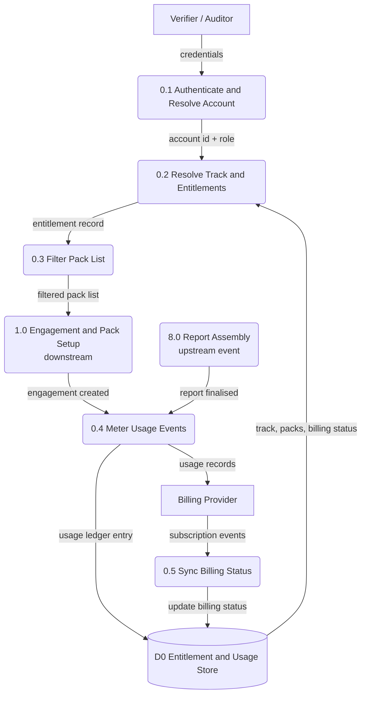
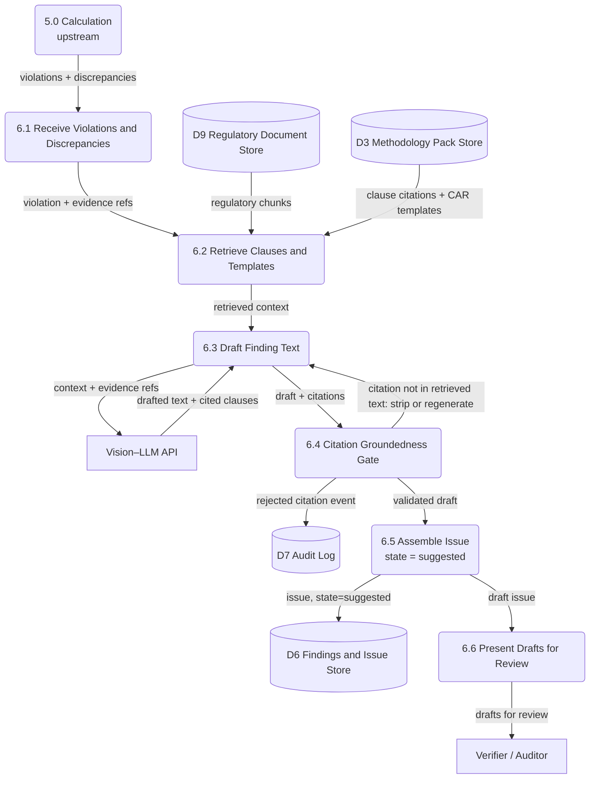
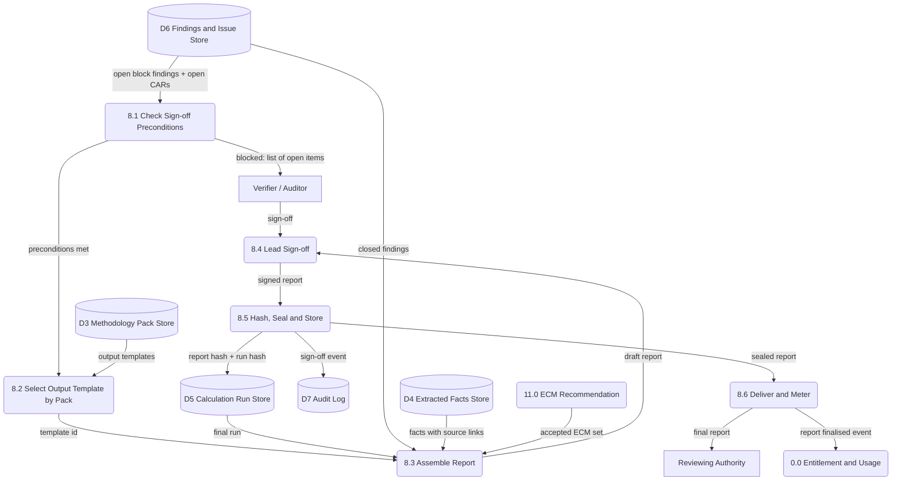
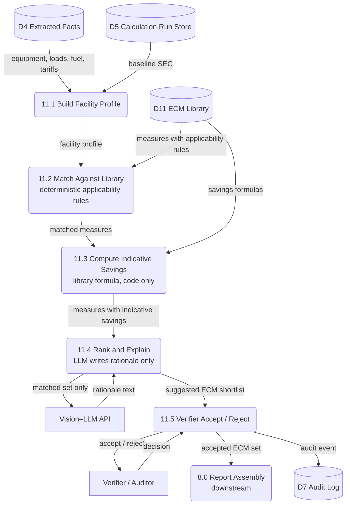
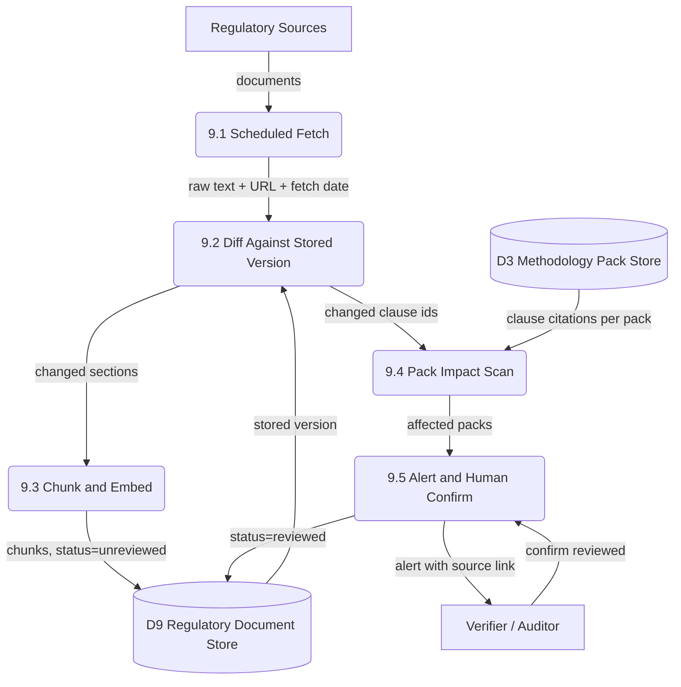
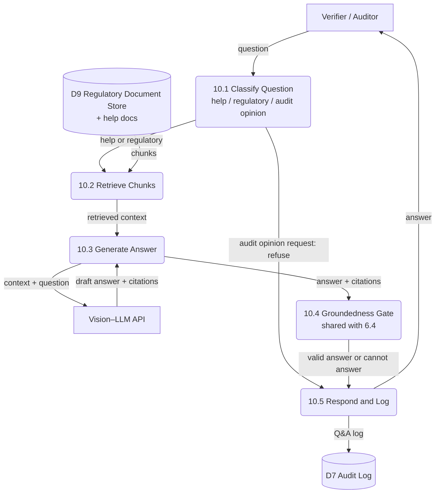
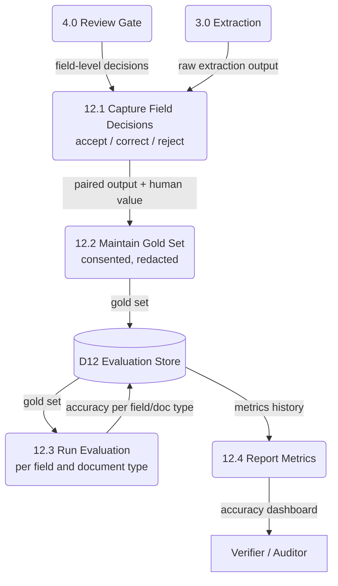

# VerifyStack — DFD v3 (on top of the current low-level DFD) and Pre-Seed / Seed Plan

**Supersedes** the architecture diagrams in my earlier v2 document. Everything here keeps your current numbering: processes 1.0–8.0, stores D1–D10, and your Level 2 diagrams for 2.0, 3.0 and 5.0. Nothing existing is renumbered or removed.

Colour key in the diagrams: **green = NEW**, **orange = MODIFIED**, uncoloured = unchanged from your current DFD.

---

# PART A — DFD v3

## A0. Review of your current DFD (fix before building on it)

1. **Finding state contradicts your own principle.** Level 1 says 6.0 writes issues as `state=open`. Principle 3 says every AI output starts `suggested`. Fix: 6.0 writes `suggested`; the verifier issuing it (7.0) moves it to `open`. Lifecycle becomes `suggested → open → responded → verified → closed` (or `rejected`).
2. **Mermaid parse risk.** The label `type=CAR|CL|FAR` contains pipes inside an edge label (`-->|"..."|`). Some renderers break on this. Use `CAR/CL/FAR`.
3. **Hard-coded 2% materiality threshold in 5.5.** Move it into the pack record (`materiality_threshold`), so it is config per scheme, not a constant in the diagram or the code.
4. **CCC derivation (5.6) uses "sector benchmark".** `[VERIFY]` As I understand CCTS, CCCs are earned or owed against the obligated entity's own notified GEI target, not a sector benchmark. Check against the CCTS notification before building further; the diagram label and the D8/D3 data source may need to change to "entity GEI target".
5. **Sign-off order in 8.0.** Your L1 shows sign-off arriving before the "zero open block findings" check. The check should gate the sign-off. Level 2 of 8.0 below fixes this.
6. **No DFD for 0.0, 6.0, 7.0, 8.0, 9.0+.** Level 2 diagrams for the ones that matter are added below.

## A1. What changes, at a glance

| ID | Type | Change | Why |
|---|---|---|---|
| 0.0 Entitlement & Track Check | NEW | Gates which packs an account can pick; meters usage | Track A/B model; per-engagement billing later |
| D0 Entitlement & Usage Store | NEW | account, track, unlocked packs, billing status, usage ledger | Same |
| 9.0 Regulatory Change Monitor | NEW | Watches sources, diffs, flags unreviewed, alerts affected packs | Differentiator; keeps D9 and clause citations current |
| 10.0 Assistant (Help + Citation) | NEW | Q&A over D9 and help docs behind the groundedness gate | Differentiator; reduces support load |
| 11.0 ECM Recommendation | NEW | Selects from curated library only; deterministic savings | ADEETIE DPRs; never lets AI invent measures |
| D11 ECM Library | NEW | Curated, practitioner-reviewed measures with formulas | Same |
| 12.0 Accuracy Evaluation | NEW | Turns human corrections into a gold set and accuracy metrics | Unmeasured extraction accuracy is open question #2 |
| D12 Evaluation Store | NEW | Gold set, field-level decisions, metric history | Same |
| 1.0 Engagement & Pack Setup | MOD | Reads filtered pack list from 0.0; emits engagement-created event | Entitlement and metering |
| 4.0 Validation & Review Gate | MOD | Also emits every accept/correct/reject decision to 12.0 | Accuracy measurement |
| 6.0 Findings Generation | MOD | Citation groundedness gate made explicit; writes `suggested` | Fix A0.1; handoff says the gate exists but your L1 hides it |
| 8.0 Review, Sign-off, Report | MOD | Template chosen per pack; takes accepted ECMs; emits usage event | Multi-scheme outputs; billing |
| 5.0 Reconciliation & Calculation | UNCHANGED structure | ADEETIE handled as pack config (see A5) | Config-not-code principle holds |
| 2.0, 3.0, 7.0 | UNCHANGED | None | |

## A2. Level 1 DFD v3 (drop-in replacement for your Level 1)

```mermaid
flowchart TB
    EE1["Verifier / Auditor"]
    EE2["Reviewing Authority<br/>(BEE / ICM / Lending Institution / EU CBAM Authority)"]
    EE3["Vision–LLM API<br/>(Gemini)"]
    EE4["Reference Data Provider<br/>(CEA / IPCC / NABL)"]
    EE5["Obligated Entity<br/>(responds to CAR/CL/FAR)"]
    EE6["Billing Provider"]
    EE7["Regulatory Sources<br/>(BEE / MNRE / EU / CEA sites)"]

    P0("0.0 Entitlement and Track Check<br/>NEW")
    P1("1.0 Engagement and Pack Setup")
    P2("2.0 Document Intake and Classification<br/>PDF · Excel · SCADA export · Lab cert")
    P3("3.0 Field Extraction<br/>Gemini + deterministic parser")
    P4("4.0 Validation and Human Review Gate")
    P5("5.0 Reconciliation and Calculation<br/>GEI / SEC / CCC / savings")
    P6("6.0 Findings Generation and Drafting<br/>CAR · CL · FAR")
    P7("7.0 Issue Lifecycle Management<br/>suggested → open → responded → verified → closed")
    P8("8.0 Review, Sign-off and Report Assembly")
    P9("9.0 Regulatory Change Monitor<br/>NEW")
    P10("10.0 Assistant: Help and Citation<br/>NEW")
    P11("11.0 ECM Recommendation<br/>NEW")
    P12("12.0 Accuracy Evaluation<br/>NEW")

    D0[("D0 Entitlement and Usage Store<br/>NEW")]
    D1[("D1 Engagement Store")]
    D2[("D2 Document Store<br/>hashed, deduped")]
    D3[("D3 Methodology Pack Store<br/>factors · schemas · rules · templates")]
    D4[("D4 Extracted Facts Store<br/>provenance-tagged")]
    D5[("D5 Calculation Run Store<br/>versioned, hash-chained")]
    D6[("D6 Findings and Issue Store<br/>CAR / CL / FAR with lifecycle")]
    D7[("D7 Audit Log<br/>append-only")]
    D8[("D8 Reference Data Cache")]
    D9[("D9 Regulatory Document Store<br/>pgvector chunks + help docs")]
    D10[("D10 Excel Pro-forma Store<br/>cell-level provenance")]
    D11[("D11 ECM Library<br/>NEW, curated")]
    D12[("D12 Evaluation Store<br/>NEW")]

    EE6 -->|"subscription status"| D0
    EE1 -->|"login"| P0
    D0 -->|"track, unlocked packs, billing status"| P0
    P0 -->|"filtered pack list"| P1
    P1 -->|"engagement created event"| P0
    P8 -->|"report finalised event"| P0
    P0 -->|"usage ledger entry"| D0
    P0 -->|"usage records"| EE6

    EE1 -->|"select engagement + sector/scheme"| P1
    P1 -->|"engagement record"| D1
    P1 -->|"request pack"| D3
    D3 -->|"pack config"| P1

    EE1 -->|"upload PDF / Excel / SCADA export"| P2
    P2 -->|"classify document type"| D3
    P2 -->|"store raw file + hash"| D2
    P2 -->|"Excel → cell-level rows"| D10
    P2 -->|"classified doc"| P3

    D3 -->|"field schema per doc type"| P3
    P3 -->|"document image/text"| EE3
    EE3 -->|"raw fields + confidence"| P3
    P3 -->|"extracted fields w/ provenance"| P4

    D10 -->|"pro-forma cell values"| P4
    P4 -->|"low-confidence / high-materiality fields"| EE1
    EE1 -->|"accept / reject / correct"| P4
    P4 -->|"committed facts"| D4
    P4 -->|"rejection events"| D7
    P4 -->|"field-level decisions"| P12
    P3 -->|"raw extraction output"| P12
    P12 -->|"gold set + metrics"| D12
    D12 -->|"accuracy report"| P12
    P12 -->|"accuracy dashboard"| EE1

    D4 -->|"committed facts"| P5
    D3 -->|"formulas + factors + rules + thresholds"| P5
    D8 -->|"reference factors + targets/benchmarks"| P5
    D10 -->|"pro-forma cells for cross-check"| P5
    EE4 -->|"published factor updates"| D8
    P5 -->|"versioned run"| D5
    P5 -->|"rule violations + cross-source discrepancies"| P6
    P5 -->|"audit event"| D7

    D9 -->|"regulatory chunks"| P6
    D3 -->|"clause citations + CAR templates"| P6
    P6 -->|"evidence refs + rule result"| EE3
    EE3 -->|"drafted CAR/CL/FAR text"| P6
    P6 -->|"issues in state=suggested, type CAR/CL/FAR"| D6
    P6 -->|"draft issues for review"| EE1
    P6 -->|"rejected citation events"| D7

    EE1 -->|"issue CAR/CL/FAR, set due date"| P7
    EE5 -->|"respond with evidence"| P7
    P7 -->|"attach response + evidence"| D6
    EE1 -->|"verify response → close or reject"| P7
    P7 -->|"update issue state"| D6
    P7 -->|"closure event"| D7

    D4 -->|"facility profile facts"| P11
    D5 -->|"baseline SEC from run"| P11
    D11 -->|"curated ECM library"| P11
    P11 -->|"suggested ECM shortlist"| EE1
    EE1 -->|"accept / reject ECM"| P11
    P11 -->|"accepted ECM set"| P8
    P11 -->|"audit event"| D7

    EE7 -->|"published regulatory updates"| P9
    P9 -->|"new or changed text + source URL + fetch date"| D9
    D3 -->|"clause citations in use"| P9
    P9 -->|"change alerts with affected packs"| EE1

    EE1 -->|"help or citation question"| P10
    D9 -->|"retrieved chunks"| P10
    P10 -->|"grounded answer + citations"| EE1
    P10 -->|"question and answer log"| D7

    EE1 -->|"lead sign-off"| P8
    P8 -->|"check: zero open block findings + zero open CARs"| D6
    D3 -->|"output template per pack"| P8
    P8 -->|"assemble report per pack template + CCC output"| D5
    P8 -->|"update finding state"| D6
    P8 -->|"append sign-off event"| D7
    P8 -->|"final report: Form B / Form C / DPR / M&V / GHCI / CBAM"| EE2

    classDef new fill:#e6f4ea,stroke:#1e8e3e,stroke-width:2px;
    classDef mod fill:#fff4e5,stroke:#e8710a,stroke-width:2px;
    class P0,P9,P10,P11,P12,D0,D11,D12,EE6,EE7 new;
    class P1,P4,P6,P8 mod;
```



## A3. Level 2 — Process 0.0 (Entitlement and Track Check)



Policy: 0.3 gates the pack picker only. Billing enforcement (blocking on non-payment or over-allowance) stays **off** until pricing is validated with real customers. 0.4 meters from day one so you have real usage data.

## A4. Level 2 — Process 6.0 (Findings Generation and Drafting)



6.4 is the same validator component used by 10.0. Build it once.

## A5. Level 2 — Process 8.0 (Review, Sign-off and Report Assembly)



## A6. How ADEETIE fits without changing 5.0

Your principle holds: ADEETIE is a **pack plus one new calculation method**, not a new process.

- **5.3** gets a new `calculation_method` value, `SAVINGS_DPR` (baseline SEC, projected savings per measure, investment, simple payback and any loan-related ratios the BEE DPR format requires). Existing GEI/SEC methods are untouched. `[VERIFY]` the exact DPR metrics against BEE's template.
- **5.4** carries the ADEETIE eligibility test (≥10% savings, valid Udyam fields, baseline completeness) as ordinary reconciliation rules in the pack.
- **5.6 (CCC)** only runs when the pack declares `ccc_enabled: true`. ADEETIE packs set it false.
- **1.0 / D1** hold the ADEETIE stage list (EOI → IGEA → DPR draft → DPR review → DPR final → loan → M&V → closed) as pack config, with stage stored on the engagement. M&V is a later re-measurement cycle that spawns a new calculation run on the same engagement, not a new process.
- **8.0** picks the BEE-format DPR or M&V report from `output_templates`.
- **11.0** is the only genuinely new ADEETIE-specific process, because DPRs recommend measures.

## A7. Level 2 — Process 11.0 (ECM Recommendation)



Rule: the LLM never adds a measure and never outputs a savings number. D11 content must be reviewed by a practitioner (mark `verified: false` until then).

## A8. Level 2 — Processes 9.0, 10.0, 12.0







Why 12.0 matters now: every accept/correct in 4.0 is already free labelled data. Capturing it gives you the extraction-accuracy number that Stage 1 and every investor conversation depends on. Use only documents the firm has consented to, redacted.

## A9. Store changes

| Store | Change |
|---|---|
| D0 (NEW) | `account_id, track, unlocked_packs[], billing_status`; `usage_ledger(account_id, engagement_id, event, ts)` |
| D1 | Add `pack_id, pack_version, engagement_stage` |
| D3 | Pack schema v2 below |
| D4 | Fact requires `document_id, page, source_text, bbox, confidence, status, committed_by` (enforced by constraint) |
| D5 | Add `pack_version, input_fact_ids, factor_versions, prev_hash, hash, report_hash` |
| D6 | State enum: `suggested, open, responded, verified, closed, rejected`; `citation_ids[]` must exist in retrieved text |
| D9 | Add `source_url, fetch_date, review_status (unreviewed/reviewed), doc_kind (regulation/help)` |
| D11 (NEW) | `measure_id, applicability_rules, savings_formula, source, verified` |
| D12 (NEW) | `field_decision(doc_type, field, model_value, human_value, decision)`, `gold_set`, `metrics_history` |

Pack record v2 (additions marked):

```
{
  pack_id, pack_version, scheme, sector_or_cluster,
  track: "A" | "B",                          // NEW  (0.0)
  entitlement_key: "...",                    // NEW  (0.0)
  engagement_stages: [...],                  // NEW  (1.0 / D1)
  document_taxonomy: [...],                  // 3.1
  field_schemas: {...},                      // 3.1 / 3.4
  confidence_thresholds: {...},              // NEW  (3.4 / 4.0), changed by pack version
  calculation_method: "GEI" | "SEC" | "SAVINGS_DPR",   // 5.1 / 5.3 (SAVINGS_DPR new)
  materiality_threshold: 0.02,               // NEW  (5.5, replaces hard-coded 2%)
  ccc_enabled: true | false,                 // NEW  (5.6)
  factors: {..., verified: bool},            // 5.1
  reconciliation_rules: [...],               // 5.4 (includes eligibility rules)
  clause_citations: [...],                   // 6.x / 9.4
  ecm_library_ref: "...",                    // NEW  (11.0)
  output_templates: ["FORM_B", "FORM_C", "DPR", "MV", "GHCI", "CBAM"],  // NEW (8.2)
  verified: bool, reviewed_by: "...", reviewed_on: "..."   // NEW
}
```

## A10. Build order for the diagram delta

1. 12.0 + D12 (capture decisions already flowing through 4.0). Cheapest, unblocks measurement.
2. Fix A0.1 (state `suggested`) and A0.3 (threshold into pack).
3. SAVINGS_DPR method, ADEETIE rules and DPR/M&V templates (5.3, 5.4, 8.2).
4. 0.0 + D0 as data model and metering only; no enforcement.
5. 6.4 validator extracted as a shared component; then 10.0 on top of it.
6. 9.0 regulatory monitor.
7. 11.0 + D11, after a practitioner has reviewed library content.
8. CBAM and GHCI packs only when a named customer asks, flagged `verified: false`.

---

# PART B — What to do at each stage

Stages are defined by **evidence**, not by cheque size or dates. Time horizons are placeholders from today (October 2026); the team sets real dates. Funding ranges are indicative and must be checked against current investor norms.

**Reality check that shapes both stages:** ADEETIE alone supports roughly ₹1–20 lakh/year of software revenue (see earlier estimate), so it can prove the product and the buying behaviour but cannot carry a seed story by itself. A seed pitch needs Track B (PAT/CCTS/GHCI/CBAM verifiers) evidence or a credible multi-scheme verifier-workflow story with proof.

## B1. Pre-seed (now to roughly month 9): prove the problem, the product on real documents, and that someone pays

**Objective:** answer the five open questions with real data: independence, extraction accuracy, willingness to pay, firm commitment, and team commitment.

### Product and engineering
| Item | Done when |
|---|---|
| 12.0 capture of field decisions; gold set from ≥3 real document sets | Accuracy per field and doc type reported weekly |
| Fix extraction on the worst error classes | ≥90% accuracy on key fields for the ADEETIE pack (target; confirm with auditors what "good enough" is) |
| ADEETIE pack hardened: SAVINGS_DPR, eligibility rules, BEE-format DPR | One auditor produces a real DPR end-to-end and says it saves time |
| Excel pro-forma ingestion and cross-check (already in D10/5.5) | Works on 3+ real auditor spreadsheets |
| State fix, threshold-in-pack, shared citation validator | Closed |
| 0.0/D0 as metering only | Usage data recorded from first pilot |
| Security basics: tenant isolation, encrypted storage, backups, access log | Written one-pager a firm can read |

### Validation and sales
- Run the discovery script from the v2 document: 10 conversations in 4–6 weeks, Luhadiya included.
- 3 shadow engagements, then 3 paid pilots (charge something small to prove payment behaviour).
- One-page shadow/pilot agreement for every firm.
- Maintain a CRM sheet: contact, credentials verified (Y/N), stage, next step, price anchor.
- Answer the independence question from at least one AEA / accreditation-aware practitioner. Record the answer verbatim.

### Company, legal and finance
- The venture is currently a single-proprietor registration with no company PAN or GSTIN. Before taking investor money, grants beyond the current ones, or larger contracts, **incorporate** (typically a private limited company; confirm with a CA). Four founders in a sole proprietorship means IP and ownership sit with one person.
- Founders' agreement: roles, equity split, vesting, what happens if someone takes a placement. Assign all IP into the company.
- GST registration and invoicing set-up once paid pilots begin `[VERIFY with CA]`.
- Customer terms: simple master agreement with data handling, confidentiality, and an explicit statement that AI drafts are suggestions and the verifier remains responsible.
- Check the LLM vendor's data terms before promising customers anything about training on their documents.
- DPDP Act obligations for personal data inside uploaded documents: get advice before Track B.
- Consider DPIIT Startup India recognition after incorporation `[VERIFY]` benefits.

### Team and governance
- Name owners: engineering, sales/BD, domain advisor. One accountable name per row of this plan.
- **Sign the commitment rule** (full-time vs placement) with a date and a trigger, before placement season forces it implicitly.
- Recruit one practitioner advisor (a senior energy auditor) with a small advisory equity grant, to review D11, DPR templates and pack factors.

### Funding at this stage
- Non-dilutive and competition money (iStart Rajasthan, BITSoM, similar): use as runway and credibility, not as the business. Finish the pending iStart compliance items.
- If raising: a small angel or pre-seed cheque (order of tens of lakhs to about ₹1 crore, indicative). Raise only on evidence from the gate below, not on the architecture.

### Do NOT do in pre-seed
New schemes or packs without a named customer; Track B enterprise sales; billing enforcement; public pricing pages; claims of BEE approval; hiring a large team.

### Exit gate to Seed (all must hold; thresholds are proposals to refine with advisors)
1. ≥8 paying firms (any track) with ≥3 repeating usage.
2. Extraction accuracy measured and ≥90% on key fields for at least the ADEETIE pack and one Track B pack.
3. ≥2 Track B pilots signed (paid or LOI) including one PAT or CCTS-Cement.
4. Independence question answered with evidence either way.
5. Price anchors from ≥5 firms; pricing tested with at least 3 who paid.
6. Company incorporated, founders' agreement signed, IP assigned.
7. Team commitment decided and dated.

## B2. Seed (roughly month 9 to 24): repeatable sales and a defensible multi-scheme story

**Objective:** turn pilots into annual contracts, show a repeatable motion, and expand carefully into Track B packs.

### Product and engineering
| Item | Done when |
|---|---|
| Billing enforcement on (0.3 gating, allowances, invoicing via billing provider) | Pricing validated; first auto-invoiced renewals |
| 9.0 Regulatory Change Monitor and 10.0 Assistant live | Used weekly; zero ungrounded citations in logs |
| 11.0 + D11 with practitioner-reviewed library | ADEETIE DPRs include ECMs; verifier accepts most suggestions |
| PAT M&V pack, CCTS Cement hardened; further CCTS sectors only on customer pull | Each pack reviewed by a named practitioner, `verified` flags cleared |
| GHCI pack once an ACVA relationship exists; CBAM pack with accredited-body input (EU first declaration due Sept 2027, so timing matters) | Content checked against primary sources and a practitioner |
| Multi-user, roles, firm-level admin, SSO if requested | Firms with 3+ seats onboard without founder help |
| Reliability and security: monitoring, backup restore tests, penetration test, documented data retention, DPDP-aligned processes | External review passed |
| Reproducibility check: re-run an old engagement and match hashes | Demonstrable to an accreditor |

### Sales and customer success
- Two-track funnels: Track A self-serve onboarding with a published price; Track B quote-led with a pilot-to-annual-contract path.
- First sales hire or formal BD owner with targets; documented sales cycle and win/loss notes.
- Customer success: onboarding checklist, support SLA, quarterly review with each Track B account.
- Case studies from real engagements (with permission) and reference calls.
- Referral loop in clusters; association partnerships.
- Track CarbonNeeti and other entrants quarterly; update positioning.

### Company, legal and finance
- Master services agreement for Track B, DPA, security questionnaire answers prepared.
- Cap table clean; ESOP pool decision; board/advisor structure.
- Monthly financial dashboard: MRR/ARR, gross margin per engagement, CAC in founder hours, burn, runway.
- Insurance and liability review (professional indemnity relevant because reports are signed).

### Team
- First hires (ordered): domain/pack engineer (energy background, authors and reviews packs), customer success/support, sales; then a second engineer. Keep total small until revenue supports it.
- Advisory board: one accreditation expert, one senior verifier, one commercial advisor.

### Funding at this stage
- Seed round (order of ₹2–8 crore, indicative) based on: Track B annual contracts, repeat usage, gross margin, and a credible case that the verifier-workflow market across PAT, CCTS, GHCI and CBAM is large enough. Investors will ask for TAM; prepare it from published numbers and your own labelled estimates.
- Use of funds tied to the gates: domain engineer, sales, security and compliance work, and runway for 18–24 months.

### Do NOT do in seed
Sell to audited entities; add unrelated "scale your SaaS" modules (DISCOM, BEE labelling, ECBC, municipal DSM); chase BRSR before the BEE verticals work; hire ahead of revenue.

### Seed readiness checklist (proposals, not investor standards)
1. ≥3 Track B annual contracts, ≥15 Track A paying firms.
2. Gross margin per engagement measured and positive after support time.
3. Net revenue retention above 100% among firms with ≥2 quarters of use.
4. Packs with `verified: true` for the ones sold; named reviewers.
5. Security review passed and documented.
6. A written answer to "why CarbonNeeti can't or won't serve this", based on customer evidence, not on the independence hypothesis alone.

## B3. One-page timeline (placeholders)

| Window | Focus | Gate |
|---|---|---|
| Month 0–1 | 10 conversations, Luhadiya call, 12.0 capture, commitment rule | Interest ≥2 of 10 |
| Month 1–3 | Real documents, accuracy fixes, ADEETIE DPR end-to-end, 3 shadow engagements | Accuracy measured, 2 LOIs |
| Month 3–6 | Paid pilots, incorporation, founders' agreement, 0.0 metering | ≥3 paying firms |
| Month 6–9 | Track B pilot (PAT/CCTS-Cement), cluster expansion, pre-seed raise if gate met | Pre-seed exit gate |
| Month 9–15 | Billing on, 9.0/10.0/11.0, PAT pack hardened, first hires | ≥3 Track B contracts in progress |
| Month 15–24 | GHCI/CBAM packs on demand, security review, seed raise | Seed readiness checklist |
