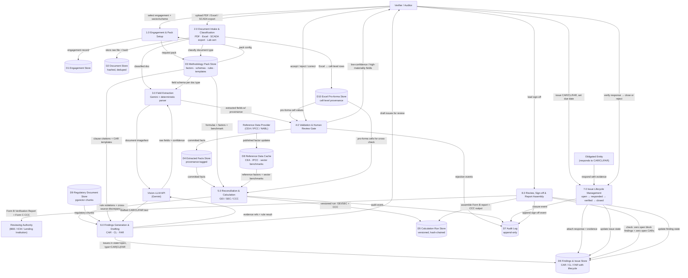
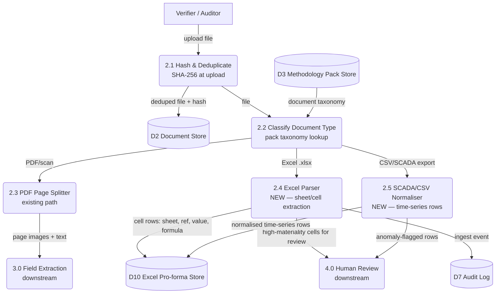
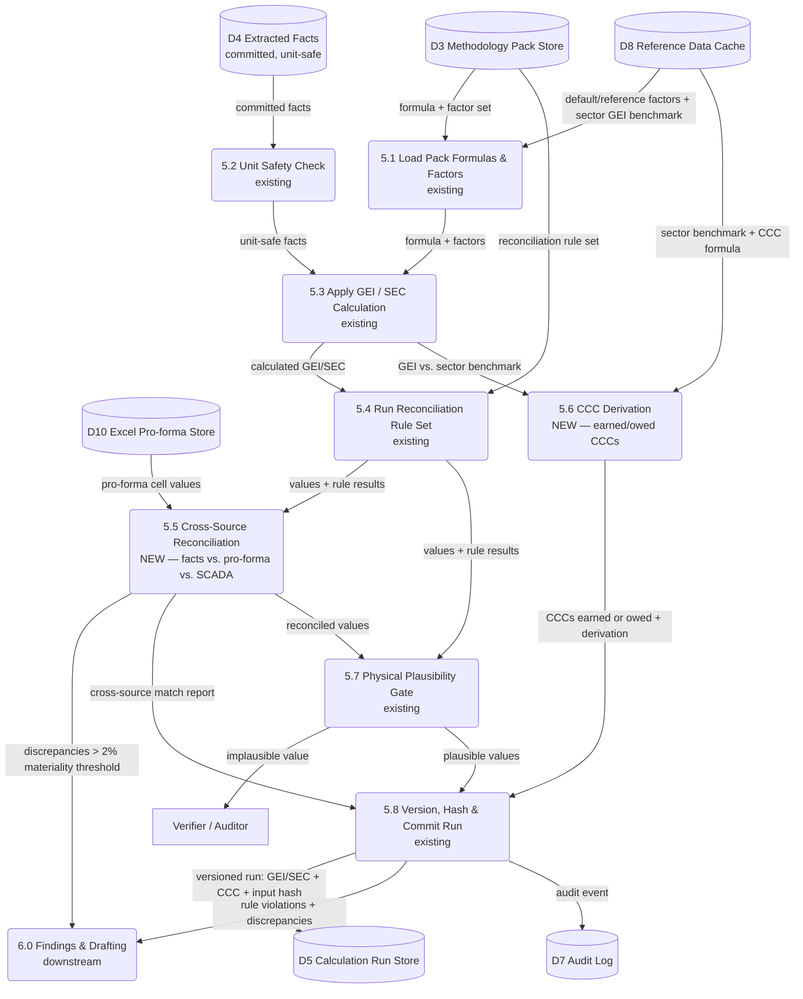

# VerifyStack — Phase 2 Agent Handoff
## Context, New DFDs, Gap Analysis, and Build Specifications

> **How to use this document.**  
> Paste this entire file as your first message to the coding agent in your IDE.  
> Read it end-to-end before writing a single line of code.  
> This builds directly on the existing system described in `VERIFYSTACK_PROJECT_PROMPT.md`,  
> the existing DFD in `verifystack_low_level_dfd.md`, and the RAG/ECM brief in  
> `verifystack_rag_ecm_implementation_brief.md`. Read those too.  
> This document describes **only the delta** — what does not exist yet and must be built.

---

## 1. What already exists (do not rebuild)

Before reading the gaps, confirm you understand what is already implemented:

| Feature | Status |
|---|---|
| P1–P7 pipeline (engagement setup → sign-off) | ✅ Built |
| 9 CCTS + 14 ADEETIE methodology packs as data | ✅ Built |
| Hashed document intake, paginated | ✅ Built |
| Gemini extraction with provenance gate | ✅ Built |
| Human review gate (accept/edit/reject) | ✅ Built |
| Deterministic GEI/SEC calculation engine | ✅ Built, hash-chained |
| Reconciliation rule set (block/warn/info) | ✅ Built |
| CAR draft from template (grounded) | ✅ Built — `domain/ai/draftCar.ts` |
| Regulatory Citation RAG (Feature 1) | ✅ Pipeline built, **synthetic corpus only** |
| ECM Library (Feature 2) | ✅ Scaffolded, `ECM_LIBRARY_PRODUCTION_READY=false` |
| ADEETIE 3-phase lifecycle (IGEA→DPR→M&V) | ✅ Built |
| 4-role RBAC, maker–checker sign-off | ✅ Built |
| Audit log (`audit_events`, `ai_action_logs`) | ✅ Built |
| VerificationReport.tsx (PDF) | ✅ Stub — shows GEI + hash only |

---

## 2. Gap analysis — what the CCTS ACVA workflow requires that we don't have

Reading the full CCTS verification pipeline, the following are missing or inadequate:

### Gap A — Excel GHG Pro-forma ingestion and validation
The BEE CCTS scheme requires verifiers to work with sector-specific **Excel pro-formas** (spreadsheets that compute GEI). Verifiers receive these from the obligated entity. Currently VerifyStack has no way to:
- Ingest an Excel file as a document
- Parse and extract structured cell values from it
- Compare those values against primary source documents
- Flag cells where the pro-forma value disagrees with extracted evidence

### Gap B — Cross-system reconciliation (SCADA vs. SAP vs. Lab vs. Pro-forma)
The existing reconciliation engine (`domain/rules/`) checks facts against pack rules. It does **not** perform cross-source reconciliation — i.e., it cannot compare:
- Fuel quantity from SCADA/DCS logs vs. SAP inventory vs. NABL lab report
- Production figures from ERP vs. excise/GST returns
- GCV from lab certificate vs. GCV entered in the pro-forma
This multi-source cross-check is the core manual bottleneck for auditors.

### Gap C — CAR / CL / FAR lifecycle (issue tracking)
`draftCar.ts` only drafts the initial CAR text. There is no:
- Issue type differentiation: CAR (Corrective Action Request), CL (Clarification Request), FAR (Forward Action Request)
- Status lifecycle: `open → responded → verified → closed` or `open → rejected`
- Auditor's response attachment (the obligated entity replies)
- Evidence attachment on responses
- Resolution record with named closer
- Due-date tracking
- Issue register view across an engagement

### Gap D — Detailed Verification Report (Form B equivalent)
`VerificationReport.tsx` is a 56-line stub that shows the facility name, GEI, and input hash. A real BEE Form B-equivalent verification report requires:
- Executive summary with verification opinion
- Scope, boundaries, and methodology statement
- Document list with provenance hashes
- Calculated GEI/SEC with derivation trail
- All findings (block/warn/info) with status and resolution
- CAR/CL register with closure evidence
- Regulatory citations supporting each finding
- Lead verifier and independent reviewer sign-off blocks with timestamps

### Gap E — Carbon Credit Certificate (CCC) calculation and output
The CCTS scheme produces **Carbon Credit Certificates** when GEI is below the sector benchmark (earned) or requires surrender when above. Currently the engine computes GEI but does **not**:
- Compute CCCs earned/owed using the official MoEFCC formula
- Produce a BEE-compliant CCC output document (Form C equivalent)
- Handle the sector benchmark lookup for CCC computation

---

## 3. Non-negotiable design invariants (inherited, never break)

These are unchanged from the original project. Violating any of them is a correctness defect, not a style choice.

1. **Code computes, models never do.** CCC calculation, Excel cross-checks, reconciliation — all deterministic code. No LLM arithmetic.
2. **No value without provenance.** Every extracted Excel cell must carry: document id, sheet name, cell reference (e.g. `B12`), and verbatim cell value. A value without that provenance is dropped to the audit log.
3. **AI proposes, humans decide.** Every AI draft (CAR text, finding explanations) is born in `suggested` state. No auto-accept.
4. **Reproducible forever.** Every calculation run — including CCC derivation — records engine version, pack version, input hash, hash-chained to predecessor.
5. **Groundedness gates are programmatic, not prompt-based.** Any AI-drafted text must be validated against its source before reaching the auditor.
6. **Fail loudly, never silently.** Missing data, reconciliation failures, unverified factors — all must error clearly, never silently produce a plausible-looking result.
7. **The capability map is the single source of truth for access.** `backend/lib/auth/capabilities.ts`. No inline permission checks.

---

## 4. Updated Level 1 DFD — Full System (Phase 1 + Phase 2)



---

## 5. Level 2 DFD — Process 2.0 (Document Intake, extended for Excel)



---

## 6. Level 2 DFD — Process 5.0 (Reconciliation & Calculation, extended)



---

## 7. New Feature Specifications

---

### FEATURE 3 — Excel GHG Pro-forma Ingestion Engine

**Goal:** Parse BEE CCTS sector Excel pro-formas (received from obligated entities) into cell-level provenance records, making every number traceable to a specific sheet + cell reference, so the reconciliation engine can compare pro-forma values against primary source evidence.

#### 7.1 Data model (new migration `0012`)

```sql
-- One row per uploaded Excel file, linked to documents table
CREATE TABLE excel_proformas (
  id UUID PRIMARY KEY DEFAULT gen_random_uuid(),
  document_id UUID NOT NULL REFERENCES documents(id),
  engagement_id UUID NOT NULL REFERENCES engagements(id),
  proforma_type TEXT NOT NULL,  -- e.g. 'CCTS-CEMENT-GEI', 'ADEETIE-SEC'
  uploaded_at TIMESTAMPTZ NOT NULL DEFAULT now(),
  schema_version TEXT NOT NULL  -- matches pack version that defines expected cells
);

-- One row per significant cell extracted from the pro-forma
CREATE TABLE proforma_cells (
  id UUID PRIMARY KEY DEFAULT gen_random_uuid(),
  proforma_id UUID NOT NULL REFERENCES excel_proformas(id),
  sheet_name TEXT NOT NULL,
  cell_ref TEXT NOT NULL,        -- e.g. 'B12', 'C45'
  field_tag TEXT NOT NULL,       -- e.g. 'coal_gcv', 'total_scope1_emissions'
  raw_value TEXT NOT NULL,       -- verbatim cell value as string
  numeric_value NUMERIC,         -- parsed, null if non-numeric
  formula TEXT,                  -- cell formula if present
  unit TEXT,                     -- extracted from adjacent label cell or pack schema
  materiality TEXT NOT NULL DEFAULT 'standard',  -- 'high' | 'standard'
  review_state TEXT NOT NULL DEFAULT 'pending',  -- 'pending' | 'accepted' | 'edited' | 'rejected'
  reviewed_by UUID REFERENCES auth.users(id),
  reviewed_at TIMESTAMPTZ,
  note TEXT
);
```

#### 7.2 Module map (`backend/domain/proforma/`)

| File | Responsibility |
|---|---|
| `types.ts` | Types: `ProformaType`, `CellTag`, `MaterialityLevel`, `ReviewState` |
| `schema.ts` | Pack-defined cell schema: maps `field_tag → sheet + expected_cell_ref + unit + materiality` |
| `parse.ts` | Parse `.xlsx` using `xlsx` (SheetJS) — **no LLM, pure deterministic** |
| `tag.ts` | Map parsed cells to `field_tag` via schema lookup |
| `validate.ts` | Validate that all mandatory cells are present; flag missing high-materiality cells |
| `ingest.ts` | Orchestrator: parse → tag → validate → insert `excel_proformas` + `proforma_cells` |

**Dependency to add:** `xlsx` (SheetJS) — MIT licence, no network calls.

#### 7.3 How it fits into intake (P2.4)
- Document type classifier in P2.2 identifies `.xlsx` files tagged as `pro_forma` in the pack taxonomy.
- Inngest background function calls `ingest.ts` → populates `proforma_cells`.
- High-materiality cells (`materiality = 'high'`) surface in the human review gate (P4) as a distinct tab alongside extracted PDF fields.
- **Reviewer accepts/edits/rejects each high-materiality cell.** Low-materiality cells are auto-accepted if they pass schema validation.

#### 7.4 UI requirement
- New tab in the workbench review page: **"Pro-forma Review"**.
- Shows cells grouped by sheet, sorted by materiality.
- High-materiality cells require explicit accept/edit/reject — same interaction pattern as PDF extraction review.
- Cell reference and sheet name visible at all times (provenance).
- Edited cells carry the reviewer's note and timestamp.

---

### FEATURE 4 — Cross-Source Reconciliation Engine (P5.5)

**Goal:** Deterministically compare values across multiple source types — extracted PDF facts, pro-forma cells, SCADA/CSV imports — and flag discrepancies above the 2% materiality threshold as reconciliation findings.

#### 7.5 Design principle
This is **pure deterministic code**. No LLM involvement in the comparison step. The LLM may draft the finding text (via the existing `draftCar.ts` path) after the discrepancy is identified.

#### 7.6 Reconciliation pairs defined in pack

Each pack in D3 declares a list of `reconciliation_pairs`:

```ts
interface ReconciliationPair {
  pairId: string;           // e.g. 'coal_gcv_proforma_vs_lab'
  description: string;
  sourceA: { type: 'extracted_fact' | 'proforma_cell'; fieldTag: string };
  sourceB: { type: 'extracted_fact' | 'proforma_cell'; fieldTag: string };
  unit: string;             // both values must resolve to this unit
  materialityPct: number;   // flag if |A-B|/A > threshold (default 2)
  clauseRef: string;        // regulatory basis for this check
  severity: 'block' | 'warn' | 'info';
}
```

#### 7.7 Module map (`backend/domain/reconcile/`)

| File | Responsibility |
|---|---|
| `types.ts` | `ReconciliationPair`, `ReconciliationResult`, `DiscrepancyFinding` |
| `resolve.ts` | Resolves a source reference to a numeric value from D4 or D10 |
| `compare.ts` | Compares two resolved values; computes discrepancy %, applies threshold |
| `run.ts` | Runs all pairs for a pack; returns `ReconciliationResult[]` |

#### 7.8 Output
`ReconciliationResult` per pair:
```ts
interface ReconciliationResult {
  pairId: string;
  valueA: { value: number; unit: string; source: string; provenance: Provenance };
  valueB: { value: number; unit: string; source: string; provenance: Provenance };
  discrepancyPct: number;
  exceeded: boolean;
  severity: 'block' | 'warn' | 'info';
  clauseRef: string;
}
```
- Results exceeding threshold are fed into P6 exactly like rule violations — they produce `RuleFinding`-shaped objects and trigger CAR drafting.
- Results are stored in `calculation_runs` JSON column (existing pattern — extend the run output shape).

---

### FEATURE 5 — CAR / CL / FAR Issue Lifecycle

**Goal:** Replace the current one-shot CAR draft with a full issue lifecycle supporting Corrective Action Requests, Clarification Requests, and Forward Action Requests, with status tracking, response management, and an issue register.

#### 7.9 Data model (new migration `0013`)

```sql
-- Replaces the current 'findings' table's CAR draft column model
-- findings table keeps its structure; issues are a separate lifecycle layer
CREATE TABLE engagement_issues (
  id UUID PRIMARY KEY DEFAULT gen_random_uuid(),
  engagement_id UUID NOT NULL REFERENCES engagements(id),
  finding_id UUID REFERENCES findings(id),  -- nullable: some issues are raised manually
  issue_type TEXT NOT NULL,                  -- 'CAR' | 'CL' | 'FAR'
  sequence_number INT NOT NULL,              -- CAR-001, CL-001, etc. per engagement
  status TEXT NOT NULL DEFAULT 'open',       
  -- 'open' | 'responded' | 'verified' | 'closed' | 'rejected'
  title TEXT NOT NULL,
  body TEXT NOT NULL,
  required_response TEXT NOT NULL,
  clause_ref TEXT NOT NULL,
  evidence_refs TEXT[],                      -- document ids referenced
  due_date DATE,
  raised_by UUID NOT NULL REFERENCES auth.users(id),
  raised_at TIMESTAMPTZ NOT NULL DEFAULT now(),
  closed_by UUID REFERENCES auth.users(id),
  closed_at TIMESTAMPTZ,
  closure_note TEXT,
  generator TEXT NOT NULL DEFAULT 'template'  -- 'template' | 'gemini'
);

CREATE TABLE issue_responses (
  id UUID PRIMARY KEY DEFAULT gen_random_uuid(),
  issue_id UUID NOT NULL REFERENCES engagement_issues(id),
  responder_id UUID NOT NULL REFERENCES auth.users(id),
  responded_at TIMESTAMPTZ NOT NULL DEFAULT now(),
  response_text TEXT NOT NULL,
  evidence_document_ids UUID[],              -- documents attached as evidence
  verifier_note TEXT,                        -- verifier's assessment of the response
  response_state TEXT NOT NULL DEFAULT 'pending'
  -- 'pending' | 'accepted' | 'rejected'
);
```

#### 7.10 Status lifecycle

```
open → responded (when obligated entity submits response)
responded → verified (when verifier reviews response, marks it adequate)
verified → closed (when lead verifier formally closes)
responded → rejected (verifier finds response inadequate; issue stays open)
open → rejected (raised in error; only before response)
```

**Sign-off gate:** Any issue in `status = 'open'` with `issue_type = 'CAR'` blocks lead sign-off. CL and FAR do not block but must be noted in the report.

#### 7.11 Module map (`backend/domain/issues/`)

| File | Responsibility |
|---|---|
| `types.ts` | `IssueType`, `IssueStatus`, `Issue`, `IssueResponse` |
| `sequence.ts` | Generates human-readable sequence number (CAR-001, CL-002…) per engagement |
| `lifecycle.ts` | State machine: `canTransition(from, to, role)` — role-gated transitions |
| `draft.ts` | Wraps `draftCar.ts` — extended to handle CL and FAR templates |
| `guard.ts` | `hasOpenBlockingIssues(engagementId): Promise<boolean>` — used by sign-off gate |

#### 7.12 New capabilities to add to `capabilities.ts`

```ts
'issues.raise'       // lead_verifier, verifier — raise a new CAR/CL/FAR
'issues.respond'     // all roles that can interact with obligated entity (firm-configured)
'issues.verify'      // lead_verifier — mark response adequate
'issues.close'       // lead_verifier — formally close
'issues.view'        // all roles
```

#### 7.13 UI — Issue Register

New page: `(app)/engagements/[id]/issues`

- Issue register table: type badge (CAR/CL/FAR), sequence number, title, status pill, due date, days outstanding.
- Click row → issue detail view: full history of status transitions, responses, and attached evidence.
- **"Raise Issue"** button opens modal: select type, enter title and body, set due date, attach finding (optional).
- Response thread rendered chronologically below the issue body.
- Filter by status, type, and severity.

---

### FEATURE 6 — Form B Verification Report (Full)

**Goal:** Replace the 56-line `VerificationReport.tsx` stub with a complete BEE-compliant verification report that assembles all verified data, findings, issue resolutions, citations, and sign-off records.

#### 7.14 Report structure

```
Section 1 — Cover Page
  Verification body name, accreditation number
  Facility name, plant, sector, compliance year
  Methodology pack + version
  Report number, issue date
  DRAFT / FINAL watermark

Section 2 — Verification Opinion
  GEI / SEC computed value
  Comparison to target / baseline
  CCCs earned or owed (CCTS only)
  Verification conclusion statement
  Signed by: lead verifier (name, date) + independent reviewer (name, date)

Section 3 — Scope and Boundaries
  Scheme, sector, compliance year
  Audit boundary (from engagement metadata)
  Methodology pack clause citation

Section 4 — Evidence Summary
  Table: document name | hash | uploaded by | date | pages reviewed
  
Section 5 — Calculation Trail
  GEI / SEC derivation table:
    stream | quantity | unit | emission/energy factor | factor vintage | tCO₂e / GJ
  Total GEI / SEC
  Engine version, input hash (verbatim from calculation_runs)

Section 6 — CCC Statement (CCTS only)
  Sector benchmark GEI
  Achieved GEI
  Net tonnes CO₂e below/above benchmark
  CCCs earned (positive) or owed (negative)
  Formula reference (MoEFCC notification)
  
Section 7 — Findings Register
  Table: finding ID | severity | rule | status | resolution | citation
  
Section 8 — Issue Register (CAR / CL / FAR)
  Table: issue ID | type | status | raised date | closed date | resolution note

Section 9 — Limitations and Assumptions
  Any draft-mode factors, missing months, unclosed issues

Section 10 — Sign-off Trail
  Lead verifier: name, role, timestamp, signature record ID
  Independent reviewer: name, role, timestamp, signature record ID
  Hash chain reference
```

#### 7.15 Module map (`backend/domain/reports/`)

| File | Responsibility |
|---|---|
| `VerificationReport.tsx` | **Rewrite** — full React-PDF implementation of sections 1–10 |
| `reportData.ts` | `assembleReportData(engagementId, runId, db)` — queries all needed data, validates completeness |
| `sections/` | One `.tsx` per section, composed into the main document |

**Constraint:** No LLM generates report text. All prose is either factual values from the database, or a fixed template. The verification opinion statement is a template filled with computed values. The auditor's sign-off is their named attestation, not an AI summary.

---

### FEATURE 7 — Carbon Credit Certificate (CCC) Derivation

**Goal:** Compute CCCs earned or owed under the CCTS scheme using the official MoEFCC formula, as a deterministic extension of the calculation engine.

#### 7.16 The formula (deterministic — code only)

```
CCC_earned = max(0, (Benchmark_GEI - Achieved_GEI) × Production_quantity)
CCC_owed   = max(0, (Achieved_GEI - Benchmark_GEI) × Production_quantity)

Where:
  Benchmark_GEI         = sector GEI benchmark published in the current CCTS cycle gazette notification
  Achieved_GEI          = GEI from the current calculation run
  Production_quantity   = production in the compliance year (same value used in GEI denominator)
  CCC_earned/owed unit  = tCO₂e
```

**Important:** Benchmark_GEI is a published regulatory value, sector-specific per compliance cycle. It must be stored in `factor_records` (existing table) under the stewardship model — platform steward sets the value, firm attests vintage. Never hard-code it.

#### 7.17 Module map (`backend/domain/calc/`)

| File | Responsibility |
|---|---|
| `ccc.ts` | **New** — `computeCcc(achievedGei, benchmarkGei, production): CccResult` |
| `run.ts` | **Extend** — call `computeCcc` after GEI run; include result in `CalcRunOutput` |

```ts
interface CccResult {
  benchmarkGei: number;
  achievedGei: number;
  productionQty: number;
  productionUnit: string;
  cccEarned: number;     // tCO₂e, 0 if none
  cccOwed: number;       // tCO₂e, 0 if none
  net: 'earned' | 'owed' | 'neutral';
  formulaRef: string;    // e.g. "MoEFCC CCTS Notification 2023, Annex III, Eq. 1"
  benchmarkVintage: string;
  benchmarkFactorId: string;
}
```

**Unit:** always tCO₂e. Same unit system as the existing engine.

---

## 8. Database migration order

Build and apply in this sequence — never skip or merge:

| Migration | Adds |
|---|---|
| `0012_proforma.sql` | `excel_proformas`, `proforma_cells`, RLS policies |
| `0013_issues.sql` | `engagement_issues`, `issue_responses`, RLS policies, sequence trigger |
| `0014_ccc.sql` | Adds `ccc_result JSONB` column to `calculation_runs`; adds CCC benchmark factor category to `factor_records` |

---

## 9. New API routes

```
POST /api/engagements/[id]/proforma          — ingest an Excel pro-forma
GET  /api/engagements/[id]/proforma          — list pro-formas + cell review status
PATCH /api/engagements/[id]/proforma/[cellId] — accept/edit/reject a cell

GET  /api/engagements/[id]/issues            — issue register
POST /api/engagements/[id]/issues            — raise a new CAR/CL/FAR
GET  /api/engagements/[id]/issues/[issueId]  — issue detail + response thread
POST /api/engagements/[id]/issues/[issueId]/respond  — submit response
PATCH /api/engagements/[id]/issues/[issueId] — update status (verify/close/reject)

GET  /api/engagements/[id]/report            — generate and stream Form B PDF
GET  /api/engagements/[id]/report/ccc        — generate CCC output (CCTS only)
```

All routes follow existing pattern: Zod-parsed bodies, `requireCapability` at entry, org-scoped data access via `lib/data/*`, audit event on every mutation.

---

## 10. New pages

```
(app)/engagements/[id]/issues                — issue register (new P7 UI)
(app)/engagements/[id]/issues/[issueId]      — issue detail + response thread
(app)/engagements/[id]/proforma              — pro-forma cell review
```

Update existing nav and capability map to include these.

---

## 11. Build order

Follow this sequence. Do not start step N+1 until step N passes `npm run typecheck && npm test && npm run lint`.

1. **Migration 0012** — `excel_proformas` + `proforma_cells` schema
2. **Proforma parse + ingest** (`domain/proforma/`) — no UI yet, unit-test with a real CCTS cement pro-forma fixture
3. **Proforma review UI** — P4 extension, new tab
4. **Migration 0013** — `engagement_issues` + `issue_responses`
5. **Issue domain** (`domain/issues/`) — types, lifecycle, draft, guard
6. **Issue API routes** — `GET/POST /issues`, `POST /respond`, `PATCH /issues/[id]`
7. **Issue register UI** — `/engagements/[id]/issues`
8. **Migration 0014** — CCC column on `calculation_runs`
9. **CCC calculation** (`domain/calc/ccc.ts`) — with golden tests
10. **Extend `run.ts`** to include CCC in output
11. **Cross-source reconciliation** (`domain/reconcile/`) — unit tests first, then integrate into P5
12. **Rewrite `VerificationReport.tsx`** — assemble full Form B, test data assembly with snapshot
13. **Update sign-off gate** — block if open CAR issues exist (call `issues.guard`)
14. **End-to-end smoke test** — full engagement from setup through Form B download

---

## 12. What the agent must NOT do

- Do not let any LLM call compute a number that flows into GEI, SEC, or CCC.
- Do not auto-accept any AI-drafted issue text. Born `suggested`, always.
- Do not ingest the entire Excel pro-forma as a blob. Cell-level provenance is mandatory — if SheetJS can't parse it, fail loudly.
- Do not skip the 2% materiality threshold on reconciliation. The threshold is regulatory. Hard-code only as a pack-configurable default.
- Do not use the service-role key on any request path that reads user data.
- Do not merge migrations. Each one must be independently reversible.
- Do not generate Form B report text with an LLM. Template + facts only.
- Do not add `if (scheme === 'CCTS')` branches to the engine. CCC derivation is controlled by a pack flag.

---

## 13. Escalate to the founder before doing any of these

- Populating `ecm_library` with any content.
- Encoding any specific BEE GEI benchmark value — get the exact figure and gazette notification reference.
- Deciding whether open CLs and FARs should block sign-off (currently the spec says no — confirm with domain advisor).
- Designing the obligated entity response portal (the entity responding to CARs may need its own login — this is a product decision, not a build decision).
- Choosing which Excel pro-forma template versions to support — BEE has updated these across cycles.

---

## 14. Testing requirements

### Unit tests (no LLM, no DB)
- `proforma/parse.ts` — fixture `.xlsx` → expected cell rows
- `proforma/validate.ts` — missing mandatory cell → error
- `reconcile/compare.ts` — known pair → expected discrepancy %
- `calc/ccc.ts` — known GEI/benchmark/production → expected CCC (golden)
- `issues/lifecycle.ts` — all valid and invalid transitions

### Integration tests
- Full proforma ingest → cells in DB with correct provenance
- Cross-source reconciliation finding → CAR drafted → issue created
- Sign-off blocked when open CAR exists
- CCC included in calculation run output JSON

### Snapshot tests
- `reportData.ts` output shape with fixture engagement
- `VerificationReport.tsx` renders without crash with minimal data

